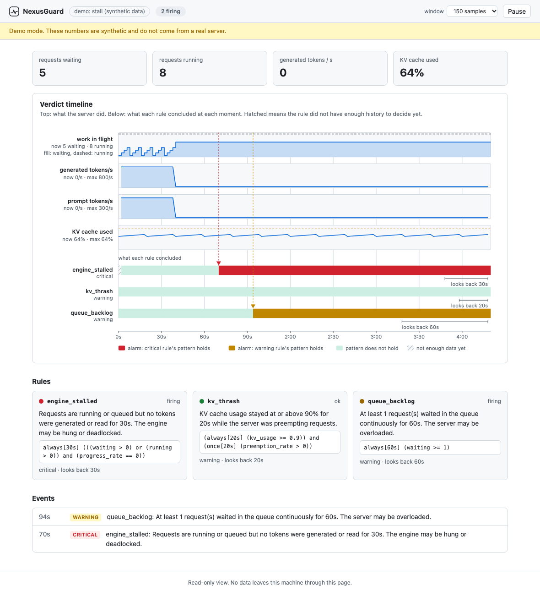

# NexusGuard

NexusGuard watches an LLM inference server's metrics (vLLM or SGLang) and tells you when the engine has stalled, the KV cache is thrashing, or the queue has stopped draining. It is a single Rust binary with a small web page for looking at what happened.



Version 0.3, early. It has been tested on synthetic traces, on traces shaped after hangs reported in vLLM's issue tracker, and on fake metrics servers. It has not been run against a live vLLM or SGLang server yet. [docs/VALIDATION.md](docs/VALIDATION.md) lists what each metric name and rule rests on.

## Why

An inference server can stop producing tokens without logging an error. vLLM's `/health` has been reported to return 200 while the engine was frozen, and the `/metrics` endpoint keeps answering, so an "is it up" probe passes. What gives it away is a pattern over time: requests are running or waiting, and no token has been generated or read for half a minute. NexusGuard checks for patterns like that.

## Try it without a GPU

```bash
cargo build --release
./target/release/nexusguard serve --demo stall
```

Open http://127.0.0.1:9100. The demo plays a synthetic server that stops making progress 40 seconds in (simulated time, replayed at two samples per second). `engine_stalled` fires at 70 s and `queue_backlog` at 94 s. Other demos: `healthy`, `thrash`, `attached-stalled`, `idle`, `long-prefill`, `hang-running-only`, `hang-saturated`.

To watch a real server:

```bash
./target/release/nexusguard serve --url http://localhost:8000/metrics
```

The metric names are detected from the page (`vllm:` or `sglang:`). Force one with `--server vllm` or `--server sglang`. SGLang must be started with `--enable-metrics`. Without the web page, `watch` does the same job and prints one JSON line per event.

## Reading the timeline

The top four strips are what the server did: requests waiting (filled) and running (dashed), tokens generated per second, prompt tokens read per second, and KV cache use. Each row underneath is one rule, coloured by what the rule concluded at that moment. The bracket under a row shows how far back the rule looks.


A rule needs a full window of history before it can say a pattern holds. If you start watching a server that is already stalled, the rule shows hatched ("not enough data yet") until the window fills, then turns red:


A rule has three possible verdicts, and the picture below shows why. One sample that breaks the pattern settles the question straight away. A window that reaches back before monitoring started, or that has a hole in it, cannot be confirmed.


Every figure here is drawn by the same code that decides the alerts. `scripts/regen-figures.sh` redraws them, and CI fails if they are out of date.

## Stuck is not the same as slow, or idle

Two shapes that look like trouble but are not:

A long prompt can keep a server busy for minutes with no output, because it is still reading. Prompt tokens count as progress, so `long-prefill` raises nothing.


An idle server has nothing running and nothing queued, and no tokens either. `idle` raises nothing.

And one shape that is trouble, which an earlier version of the rule missed. People reported vLLM hangs with log lines like `Running: 1 reqs, Waiting: 0 reqs, KV cache usage: 9.6%` and 0.0 tokens/s ([issue #18431](https://github.com/vllm-project/vllm/issues/18431)). The queue is empty, so a rule that waits for a queue misses it. NexusGuard counts a running request as work:


## What it checks

| Rule | Severity | Fires when |
|---|---|---|
| `engine_stalled` | critical | for 30 s, something was running or waiting, and no token was generated or read |
| `kv_thrash` | warning | for 20 s, KV cache use stayed at 90% or more, and at least one preemption happened in that time |
| `queue_backlog` | warning | for 60 s, at least one request was always waiting |

Every number is a flag (`--stall-secs`, `--thrash-secs`, `--kv-threshold`, `--backlog-secs`, `--backlog-min`). `nexusguard rules` prints the active rules and the signals each one needs.

Each rule fires once when its pattern starts to hold and sends a `recovered` event when it stops. It does not repeat on every scrape. `watch` and `serve` also report `scrape_failing` when the metrics endpoint cannot be read three times in a row.

If a server does not export a metric a rule needs, that rule is disabled and the web page says why. SGLang has no preemption counter, so `kv_thrash` is off for it.

If the metrics endpoint goes quiet for a while, a rule will not treat the silent stretch as evidence. After an outage, a rule waits until its window is filled with fresh samples before it can fire.

## Commands

| Command | What it does |
|---|---|
| `serve` | `watch` plus a local web page. `--demo SCENARIO` plays synthetic data. |
| `watch` | Scrape on an interval and print an event when a rule starts or stops firing. |
| `replay FILE` | Run a recorded trace (JSON lines) through the rules. Exits 2 if a rule fired, so it works as a CI check. |
| `render FILE` | Draw a trace as the timeline SVG. |
| `simulate SCENARIO` | Print a synthetic trace. |
| `rules` | Print the active rules. |

`watch` and `serve` can send events elsewhere, both off by default: `--webhook URL` posts each event as JSON, and `--exec PROGRAM` runs a program (no shell) with the event on stdin. `serve` listens on 127.0.0.1 only and has no login, so keep it on loopback unless you put something in front of it.

## How it works


Each scrape becomes a sample. The trace keeps a bounded history and works out per-second rates from the counters, treating a drop in a counter as a restart, as Prometheus does. Rules are small formulas over that history: comparisons, `and`, `or`, `not`, and two time-bounded operators, "always for the last N seconds" and "at some point in the last N seconds". [docs/DESIGN.md](docs/DESIGN.md) has the details.

## Limits

- It has not been run against a live vLLM or SGLang server. The metric names come from the servers' documentation and source ([docs/VALIDATION.md](docs/VALIDATION.md)). Names change between versions, and the parser tries the known alternatives.
- It sees aggregate numbers only: queue length, running count, token counters. It cannot say which request is stuck, or catch one request starving while others make progress.
- A stall is "work in flight and no tokens". If clients hang while the server reports nothing running and nothing queued, nothing matches.
- It reports and does nothing else. Use `--exec` to hook an alert up to your own action.
- The default thresholds are guesses and have not been tuned on real traffic.
- If scrapes are far apart compared with a rule's window, the window holds too few points to mean much. `watch` warns when the interval is more than a third of the shortest window.
- Text Generation Inference is not supported, because it only counts generated tokens when a request finishes ([why](docs/VALIDATION.md#not-supported)).
- It is runtime monitoring, not a proof about the server. The rule logic itself is checked with property-based tests.

## Development

```bash
cargo test
cargo clippy --all-targets -- -D warnings
cargo fmt --check
```

See [CONTRIBUTING.md](CONTRIBUTING.md). If you run a real server, the most useful thing you can send is a sample of its `/metrics` page: there is an issue template for it.

## License

Dual-licensed under [MIT](LICENSE-MIT) or [Apache-2.0](LICENSE-APACHE), at your option.
